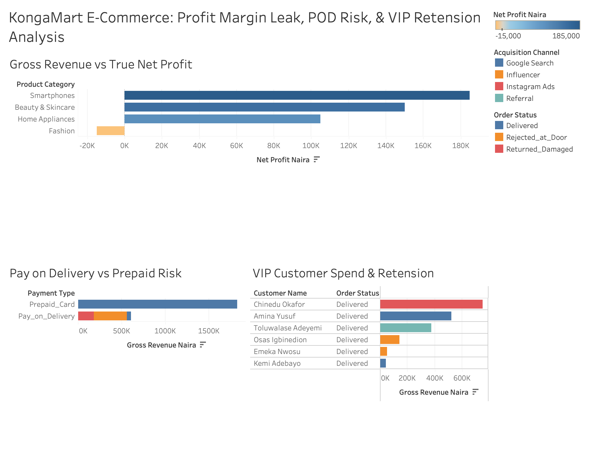

# 🛒 KongaMart E-Commerce: Profit Margin Leak, POD Risk & VIP Retention Analysis
**Tools Used:** MySQL (Net Profit Margin Math, `CASE WHEN` Customer Tiering, `MAX()` Churn Tracking) | Tableau (Executive Profitability Dashboard)

## 📌 Executive Summary
KongaMart is a multi-category E-Commerce retailer operating across Nigeria. Despite strong top-line Gross Merchandise Value (GMV), leadership noticed shrinking cash flow and high logistics losses. 

I conducted a deep-dive SQL and Tableau audit across `Orders_Log` and `Customers` to separate vanity gross revenue from **True Net Profit**, quantify **Pay-on-Delivery (POD)** rejection losses, and segment customers into actionable retention tiers.

---

## 📊 Executive Profitability & Retention Dashboard (Tableau)

---

## 🔍 Key Business Insights Uncovered (via MySQL)

### 1. The "Vanity Revenue" Trap: Why the Fashion Category is Losing Money
- By calculating `SUM(Gross_Revenue_Naira - Product_Cost_Naira - Discount_Given_Naira) AS True_Net_Profit`, I uncovered a critical margin leak:
  - **Smartphones:** ₦1,050,000 Gross Revenue $\rightarrow$ **+₦185,000 Net Profit**
  - **Beauty & Skincare:** ₦270,000 Gross Revenue $\rightarrow$ **+₦150,000 Net Profit** *(Highest profit margin % due to minimal discounting!)*
  - **Home Appliances:** ₦370,000 Gross Revenue $\rightarrow$ **+₦105,000 Net Profit**
  - **Fashion:** ₦190,000 Gross Revenue $\rightarrow$ **-₦15,000 Net Loss!** *(Aggressive promotional discounts totaling ₦95,000—50% of gross revenue—completely wiped out product margins).*

### 2. Pay-on-Delivery (POD) Logistics Bleed
- **Prepaid Card Orders:** Achieved a **100% delivery success rate** (11 of 11 delivered, ₦0 lost revenue).
- **Pay-on-Delivery (POD) Orders:** Suffered an **80% failure rate** (4 out of 5 orders were `Rejected_at_Door` or `Returned_Damaged`), resulting in **₦560,000 in uncollected/lost gross revenue** and wasted two-way courier costs.

### 3. VIP Whale Churn Detection (`MAX(Order_Date)` & `CASE WHEN` Segmentation)
- Segmented customers into **`VIP Whale` (≥₦300k)**, **`Regular Buyer` (≥₦100k)**, and **`Low-Spend Buyer` (<₦100k)**.
- Identified that our top two **VIP Whales**—**Chinedu Okafor (₦750,000 spent)** and **Amina Yusuf (₦520,000 spent)**—have not placed an order since **July and August 2026**, signaling high churn risk if not re-engaged immediately.

---

## 💡 Strategic Recommendations for Management
1. **Cap Promotional Discounts in Fashion at 15%:** Eliminate 50% promo codes on Fashion items immediately to restore positive net contribution margins.
2. **Restrict Pay-on-Delivery (POD) for High-Ticket Orders:** Require a mandatory 10% prepaid commitment fee or restrict POD to orders under ₦50,000 to eliminate the ₦560,000 door-rejection bleed.
3. **Automated VIP Win-Back Campaign:** Trigger a personalized loyalty call and exclusive Smartphone/Appliance bundle offer to inactive VIP Whales (`Chinedu Okafor` & `Amina Yusuf`) after 45 days of inactivity.
